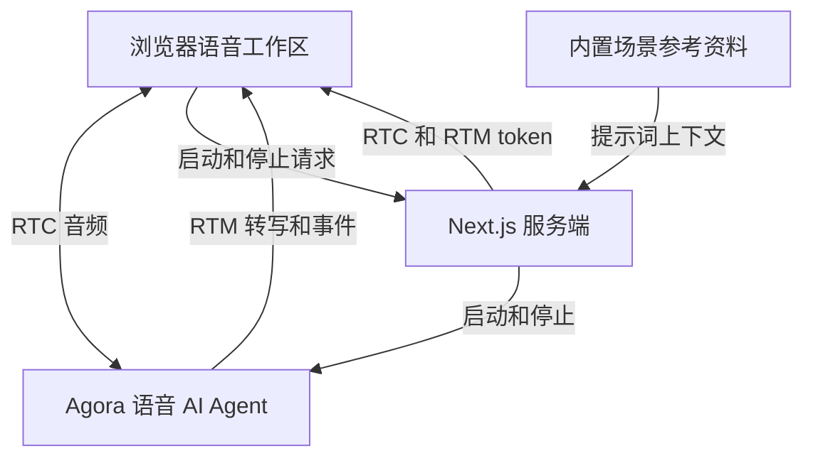

# Agora 旅行预订助手演示

[English](README.md) | [简体中文](README.zh-CN.md) | [日本語](README.ja.md)

本文仅翻译文档；应用界面和语音对话仍使用英语。请使用下方英文示例试说，中文仅供理解。

基于 Agora 和 Next.js 的旅行规划语音 AI 演示。讨论巴港或阿卡迪亚行程、比较虚构酒店，并体验模拟酒店预订。

**[在 Agora Recipes 探索更多语音 AI 演示 →](https://recipes.agora.io/)**

[](https://www.agora.io/en/products/conversational-ai-engine/)
[](https://nextjs.org/docs)
[](LICENSE)

[功能](#features) · [技术栈](#tech-stack) · [本地运行](#run-locally) · [部署到 Vercel](#deploy-to-vercel) · [使用流程](#how-it-works) · [定制](#customize) · [常见问题](#faq) · [更多](#more)

<a id="what-you-can-do"></a>

<a id="features"></a>

## 功能

- **目的地规划：** 讨论巴港 / 阿卡迪亚旅行的日期、同行需求、预算和偏好。
- **机场选择：** 比较前往巴港和阿卡迪亚的 BHB、BGR 和 PWM 机场。
- **酒店比较：** 了解预设虚构酒店的房型、位置和示例价格。
- **模拟预订：** 核对住宿摘要和示例总额，再确认或修改对话中的计划。
- **语音与转写：** 通过音频和文字跟随旅行规划问答。

<a id="tech-stack"></a>

## 技术栈

- **前端：**  Next.js、React、TypeScript。
- **语音 AI：**  Agora Conversational AI、Agents SDK、RTC、RTM。
- **模型：**  Deepgram STT、OpenAI LLM、MiniMax TTS。

<a id="quick-start"></a>

<a id="run-it"></a>

<a id="try-it"></a>

<a id="conversation"></a>

## 快速开始

<a id="run-locally"></a>

### 本地运行

需要 Node.js 24、pnpm 9.15.9，以及已启用 Conversational AI 的 [Agora 项目](https://console.agora.io/)。

**1. 安装与配置**

克隆或下载本仓库，然后在仓库目录中打开终端。

```bash
pnpm install --frozen-lockfile

if [ ! -f .env.local ]; then
  cp env.local.example .env.local
fi
```

在 [Agora Console](https://console.agora.io/) 创建或选择项目。打开 **Manage credentials**，将 **App ID** 和 **Primary certificate** 复制到 `.env.local`（[操作说明](https://docs.agora.io/en/introduction/console-setup)）：

```dotenv
NEXT_PUBLIC_AGORA_APP_ID=your_agora_app_id
NEXT_AGORA_APP_CERTIFICATE=your_agora_app_certificate
```

默认语音和语言模型无需单独配置 API Key。App Certificate 仅限服务端使用，请保存在 `.env.local`，不要暴露在浏览器代码中。配置模板见 [env.local.example](env.local.example)。

**2. 启动应用**

```bash
pnpm run doctor
pnpm run dev
```

打开 [http://localhost:3000](http://localhost:3000)，选择 **Review travel plans** 并允许使用麦克风。需要时可请助手总结对话，点击挂断按钮（**End session**）结束。

<a id="deployment"></a>

<a id="deploy-to-vercel"></a>

### 部署到 Vercel

[](https://vercel.com/new/clone?repository-url=https%3A%2F%2Fgithub.com%2FAgoraIO-Community%2Fagora-travel-booking-assistant-demo&env=NEXT_PUBLIC_AGORA_APP_ID%2CNEXT_AGORA_APP_CERTIFICATE&envDescription=Agora%20App%20ID%20and%20App%20Certificate%20from%20Agora%20Console.%20Enable%20Conversational%20AI%20for%20the%20project.&envLink=https%3A%2F%2Fdocs.agora.io%2Fen%2Fintroduction%2Fconsole-setup&project-name=agora-travel-booking-assistant-demo&repository-name=agora-travel-booking-assistant-demo)

1. 点击按钮，将本仓库克隆到你的 Git 账户并导入 Vercel。
2. 选择 **Next.js** 和 Node.js 24。
3. 在 **Environment Variables** 中填写 `NEXT_PUBLIC_AGORA_APP_ID` 和 `NEXT_AGORA_APP_CERTIFICATE`，然后部署。

<a id="how-it-works"></a>

## 使用流程

1. **开始对话：** 选择 **Review travel plans** 并允许使用麦克风。
2. **描述旅行：** 说明巴港或阿卡迪亚之旅的日期、同行人员和偏好。
3. **比较选项：** 讨论机场和示例酒店。
4. **核对计划：** 检查日期和价格后，确认或修改模拟住宿。

### 架构



Next.js 签发浏览器 token，并在启动 Agora Agent 时提供场景指令。对话行为由提示词驱动，未连接实时业务系统。详见 [ARCHITECTURE.md](ARCHITECTURE.md)。

<a id="faq-and-limitations"></a>

<a id="faq"></a>

## 常见问题

### 运行演示需要航班或酒店 API 吗？

不需要。演示自带机场参考资料和模拟预订所用的示例酒店。

### 可以问助手什么？

说明目的地、日期、同行人员和预算。可以说：“Help me plan a family trip to Bar Harbor and Acadia”（意为“帮我规划去巴港和阿卡迪亚的家庭旅行”），然后比较机场或示例酒店。在确认模拟住宿前可以修改计划。

### 为什么预订示例只覆盖巴港和阿卡迪亚？

内置酒店数据仅覆盖这些目的地。其他目的地提供一般规划建议。演示其他目的地可替换酒店和机场资料；真实搜索和预订需要接入旅行服务商。

### 为什么无法启动语音会话？

检查浏览器麦克风权限、输入设备、Agora App ID、App Certificate 和 Conversational AI 权限。请使用 localhost 或 HTTPS。运行 `pnpm run doctor` 检查本地配置，再按页面错误提示重试。

### 可以保存对话副本吗？

可以。在 Inspector 中选择 **Export session evidence**，将当前或最近一次通话下载为 JSON。请在开始新通话或刷新页面前导出。

<a id="customize"></a>

### 如何让演示更贴近真实业务？

通过 [RAG](https://docs.agora.io/en/ai/build/custom-model-integration/custom-llm)、[工具调用](https://docs.agora.io/en/ai/build/tools/custom-tools)或 [MCP](https://docs.agora.io/en/ai/build/tools/mcp-tools) 连接自己的知识库和业务服务。 添加工具时，在 [Agent 配置](app/api/invite-agent/route.ts)中将 `advancedFeatures.enable_tools` 设为 `true`。

### 如何适配自己的场景？

按你的场景定制 Agent 提示词、业务工具和界面。

## 许可与来源

采用 [MIT License](LICENSE)。请保留[第三方声明](THIRD_PARTY_NOTICES.md)。

<a id="more"></a>

## 更多

- **[Recipes](https://recipes.agora.io/)：** 探索更多 Agora 演示与集成。
- **[Docs](https://docs.agora.io/en/ai)：** 学习构建和扩展语音 Agent。
- **[Console](https://console.agora.io/)：** 创建项目，管理凭据和用量。
